<div align="center">


**An AI agent workspace for authorized security testing.**

Bring any model. Fathom gives it a shell, a real browser, a pentest toolkit, scope guardrails and an evidence-first way of working, in a local web UI or a desktop app for Windows and Linux.

[Top features](#top-features) · [How it compares](#how-fathom-compares) · [Quick start](#quick-start) · [Walkthrough](#a-session-from-start-to-finish) · [Documentation](#documentation)

</div>

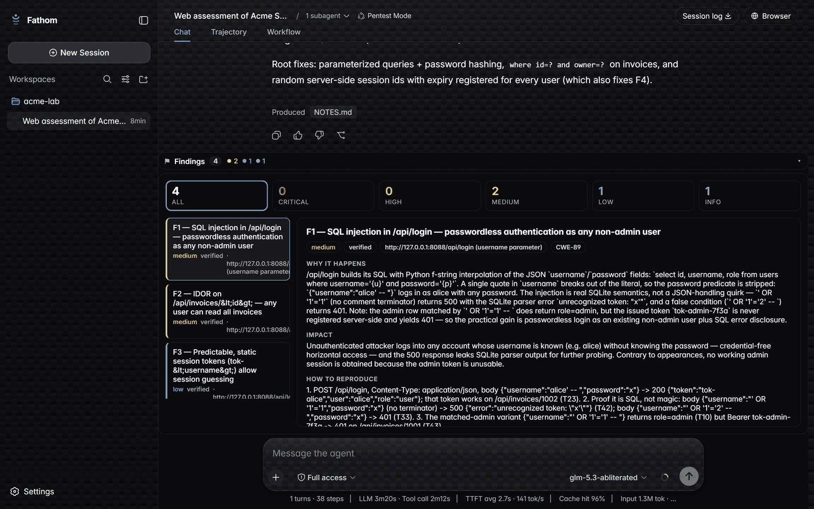

<sub>A real Pentest Mode run against a deliberately vulnerable lab app on `127.0.0.1`: four findings, each with recorded HTTP evidence, a root cause and reproduction steps.</sub>

---

Fathom runs an AI agent on your own machine and points it at targets you are allowed to test: your own apps, client engagements, bug bounty programs, labs and CTFs. You describe the job in plain language; the agent plans, runs tools, records what it finds, has it independently re-verified and writes the report, while you watch every step and can stop, steer or take over at any time.

## Top features

| | Feature | What it means in practice |
|:-:|---|---|
| 1 | **Blind, independent validation** | A finding is marked *verified* only after a **different agent** reproduces it from the write-up alone. `validation_brief` hands the validator the claims, threat model and steps, never the finder's raw requests or notes, so it cannot copy the answer. `record_validation` refuses a verdict from the session that found the bug, and a "not reproduced" verdict must list the attempts behind it. Enforced in code, not left to the prompt. |
| 2 | **Scope enforced in code** | After `set_scope`, every shell command, `http_request`, browser navigation and web fetch is checked for hosts, IPs and CIDRs before it runs, and anything outside scope is refused. Wildcards, URLs and alternate spellings of an excluded host are refused too. Widening scope asks you. Out-of-band callback services (interactsh, Burp Collaborator, webhook.site) are always allowed. |
| 3 | **"Intended" and "do not test" are first-class** | Tell Fathom what is by design and what is off-limits once. Both are stored with the scope, shown to every subagent, and written into every validation brief, so by-design behaviour is never reported and off-limits functionality is never touched. |
| 4 | **Evidence bound to every finding** | Each `http_request` is saved as numbered traffic (`T1`, `T2`, …) with the full request and response. Findings cite traffic IDs, and reports quote the real exchange. |
| 5 | **You watch, steer and take over** | Every step streams into the UI as an expandable row. Send a message mid-run to steer, stop it, or answer its questions. The agent's Chromium is shared with you: take over for a CAPTCHA or a login, then hand it back. |
| 6 | **Breadth, then depth, with subagents** | The lead splits the app into subsystems (auth, upload, sharing, payments, admin, API, integrations…) and gives each its own subagent that tests it completely, while it keeps the plan and the report. A PoC that fails twice can go to `subagent_escalate`, pinned to a stronger model you choose. |
| 7 | **Built for long engagements** | An asset graph, an exploration graph (tried, yielded, ruled out), the findings store and a running notes ledger live in files, so they survive context compaction, resume and fork. Past sessions are searchable, so work is not repeated. |
| 8 | **63 bug-class skills** | One `hunt-*` skill per class (IDOR, auth bypass, OAuth, SAML, JWT, SSRF, RCE, SQLi, SSTI, XXE, XSS, CSRF, CORS, GraphQL, gRPC, HTTP smuggling, LLM features…), plus method, triage and reporting. Fathom's own **patch-diff** skill finds n-days by diffing a security release, and **docker-replica** develops risky exploits on a local copy of the target's software first. |
| 9 | **Bug Bounty Mode** | Reads the program policy first, hunts what scanners miss, and writes one submission-ready report per finding (asset, weakness, severity, steps, impact, recorded traffic, fix, redaction reminder). Unverified findings are marked as drafts. |
| 10 | **Guardrails against noise and manipulation** | Brute force, sqlmap OS shells and Metasploit ask first; DoS tooling is denied. Loud scanner settings are flagged and requests per host are rate-capped. Target output that tries to instruct the agent is wrapped as untrusted. |
| 11 | **A toolkit that installs itself** | 31 tools (nmap, ffuf, nuclei, sqlmap, httpx, subfinder, katana, gobuster, hydra, testssl…) installed in the background while the agent works, natively on Linux or via WSL or native builds on Windows, with SHA-256 checks. No Docker required. |
| 12 | **Any model, your keys** | OpenAI, Anthropic, Google, Mistral, Groq, OpenRouter, Azure, Bedrock, Vertex or any OpenAI-compatible gateway, chosen per session. Keys stay in an owner-only file on your machine. |
| 13 | **Web UI and desktop app** | A local web UI, plus a native desktop app for Windows and Linux with tray, notifications when the agent needs you, and one-click update. |
| 14 | **Everything is a plugin** | Persona, tools, guardrails, skills, model adapters and UI panels are all plugins. Copy a mode and change it, or replace any part, without forking the core. |

<table>
<tr>
<td width="50%">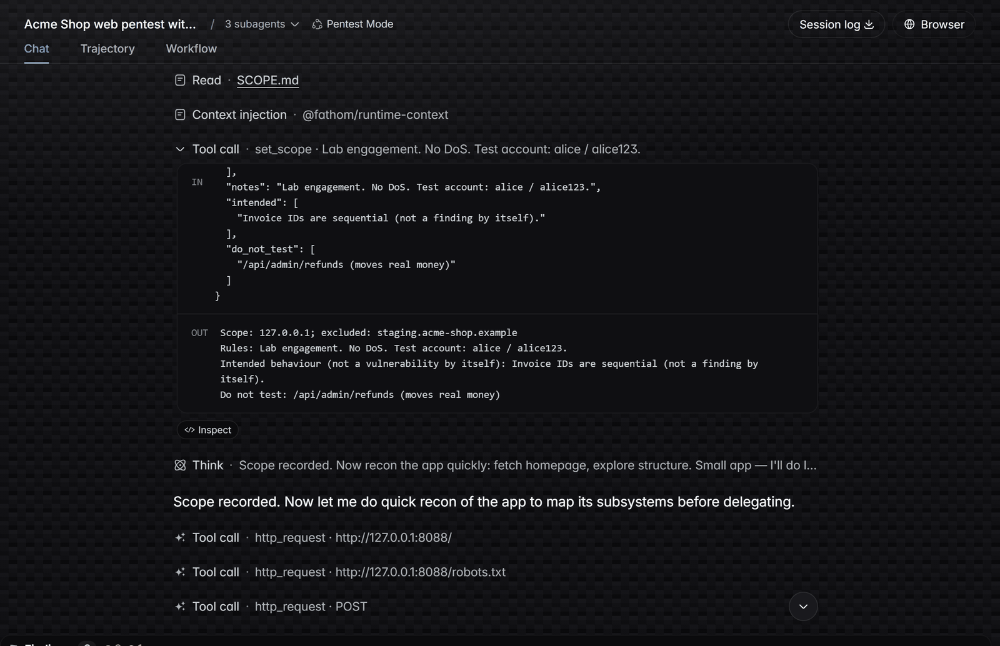</td>
<td width="50%">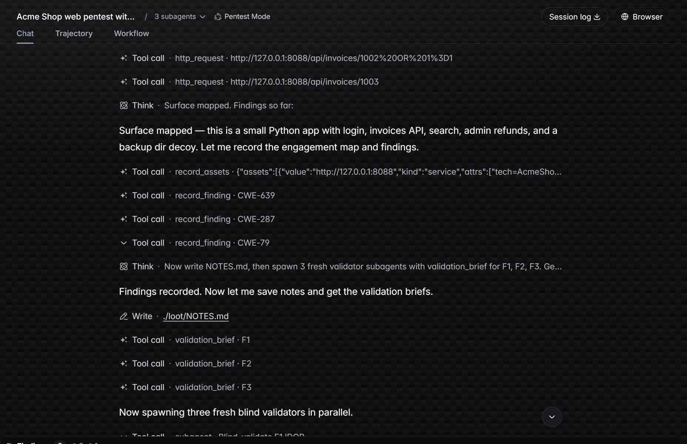</td>
</tr>
<tr>
<td><sub><b>Scope, intended design and off-limits areas</b> recorded once with <code>set_scope</code>, then enforced on every call and passed to every validator.</sub></td>
<td><sub><b>Blind validation</b>: one <code>validation_brief</code> per finding, each handed to a fresh subagent that never sees the finder's requests.</sub></td>
</tr>
<tr>
<td>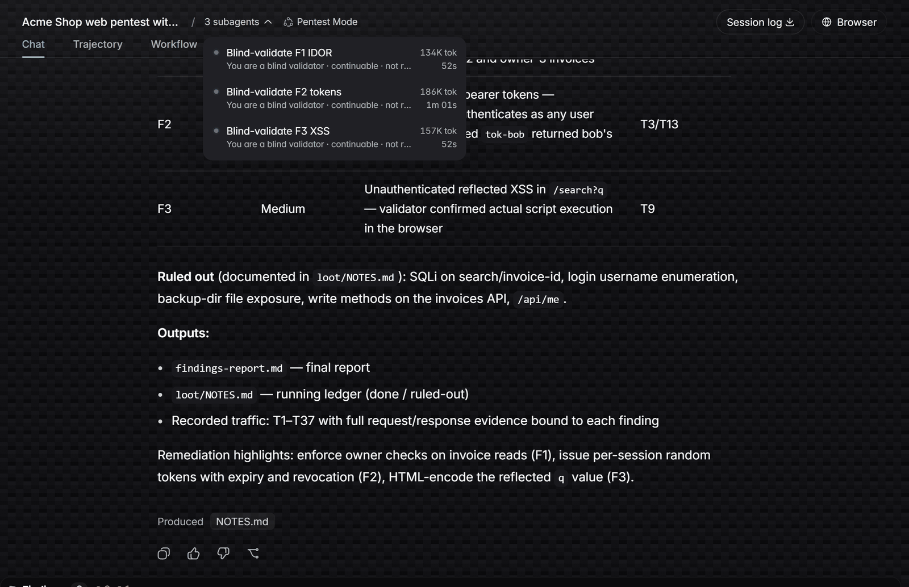</td>
<td>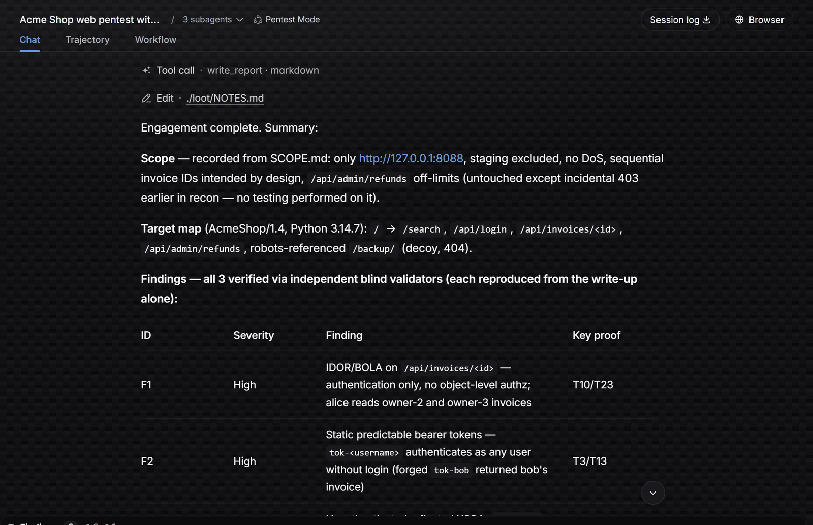</td>
</tr>
<tr>
<td><sub><b>Validators run in parallel</b> as background subagents, each with its own context and token count.</sub></td>
<td><sub><b>Only reproduced findings are verified.</b> The off-limits refunds endpoint was left untested, and the by-design sequential IDs were not reported.</sub></td>
</tr>
</table>

## How Fathom compares

Most open-source AI pentest agents are autonomous scanners: you start a run, wait, and read a report. Fathom is a workspace for a human and an agent testing together, with the rules of engagement enforced by the harness rather than trusted to the model.

| | **Fathom** | [Strix](https://github.com/usestrix/strix) | [Shannon](https://github.com/KeygraphHQ/shannon) | [PentAGI](https://github.com/vxcontrol/pentagi) | [PentestGPT](https://github.com/GreyDGL/PentestGPT) | [HexStrike AI](https://github.com/0x4m4/hexstrike-ai) |
|---|---|---|---|---|---|---|
| Interface | Web UI + desktop app (Windows, Linux) | CLI + results viewer | CLI | Web UI | CLI | MCP server for an external AI client |
| Steer the agent live | ✅ chat, stop, answer questions | — | — | ✅ Assistant view | ✅ interactive mode | via the AI client |
| Take over the agent's browser | ✅ | — | — | — | — | — |
| Scope enforced in code | ✅ blocks out-of-scope calls | — | — | — | — | — |
| Validation of findings | ✅ blind, by a separate agent, enforced | PoC per finding | "No exploit, no report" | — | — | — |
| Recorded traffic bound to findings | ✅ | — | — | — | — | — |
| Intended / do-not-test rules | ✅ stored, enforced, sent to validators | — | rules of engagement in config | — | — | — |
| Bug bounty submission reports | ✅ one per finding | — | — | — | — | — |
| Model choice | Any provider or OpenAI-compatible endpoint | Many (LiteLLM) | Many | Many | Claude Code or Codex (autonomous mode) | Whatever the MCP client uses |
| Needs Docker | No | Yes | Yes | Yes (Compose) | Optional | No (tools installed by hand) |
| Tool installation | Automatic, checksummed | In sandbox image | In worker image | In sandbox image | Docker image or manual | Manual (150+ tools) |
| Long sessions | Compaction-proof engagement files, resume, fork, search | — | Resumable workspaces | Vector memory, summarization | Resumable sessions | — |
| License | MIT | Apache-2.0 | AGPL-3.0 | MIT | MIT | MIT |

<sub>"—" means the project's README does not describe the feature, not that it is impossible. Compared against each project's README in November 2026; corrections are welcome. CAI is left out because it was archived in August 2026.</sub>

**Where others are stronger today:** Strix and Shannon have dedicated white-box modes that analyze a repository before attacking (Fathom's agent can read source in its workspace, but has no separate SAST stage), and both ship CI integrations and, for Shannon, SARIF output. PentAGI has a vector memory store and an optional knowledge graph. If you need an unattended scan in a CI pipeline, one of those may fit better; if you want a controllable agent on a real engagement, that is what Fathom is built for.

## Contents

- [Top features](#top-features)
- [How Fathom compares](#how-fathom-compares)
- [Quick start](#quick-start)
- [A session from start to finish](#a-session-from-start-to-finish)
- [Features](#features)
- [Configuration](#configuration)
- [Where your data lives](#where-your-data-lives)
- [How it is built](#how-it-is-built)
- [Documentation](#documentation)
- [Use it responsibly](#use-it-responsibly)
- [License](#license)

## Quick start

You need Git, [Node.js](https://nodejs.org) 20 or newer (22 recommended) and pnpm (`npm i -g pnpm`).

```sh
git clone https://github.com/Pro-Nil/fathom.git
cd fathom
pnpm install
pnpm build
pnpm fathom web
```

Then:

1. Open **http://127.0.0.1:2323** (use `pnpm fathom web --port 3000` for another port).
2. Go to **Settings → Models**, choose **Add provider**, paste an API key, and save. For a self-hosted model or a gateway, choose **Add a custom provider** instead ([details](docs/guide/models.md)).
3. Add a **workspace**: the folder the agent works in. Put a `SCOPE.md` with your rules of engagement there.
4. Pick **Pentest Mode** or **Bug Bounty Mode**, describe the job, and send.

Want the desktop app, Linux setup, or to update an existing install? **[docs/UPDATING.md](docs/UPDATING.md)** covers first installs (web or desktop, Windows or Linux), updates and troubleshooting.

<table>
<tr>
<td width="50%">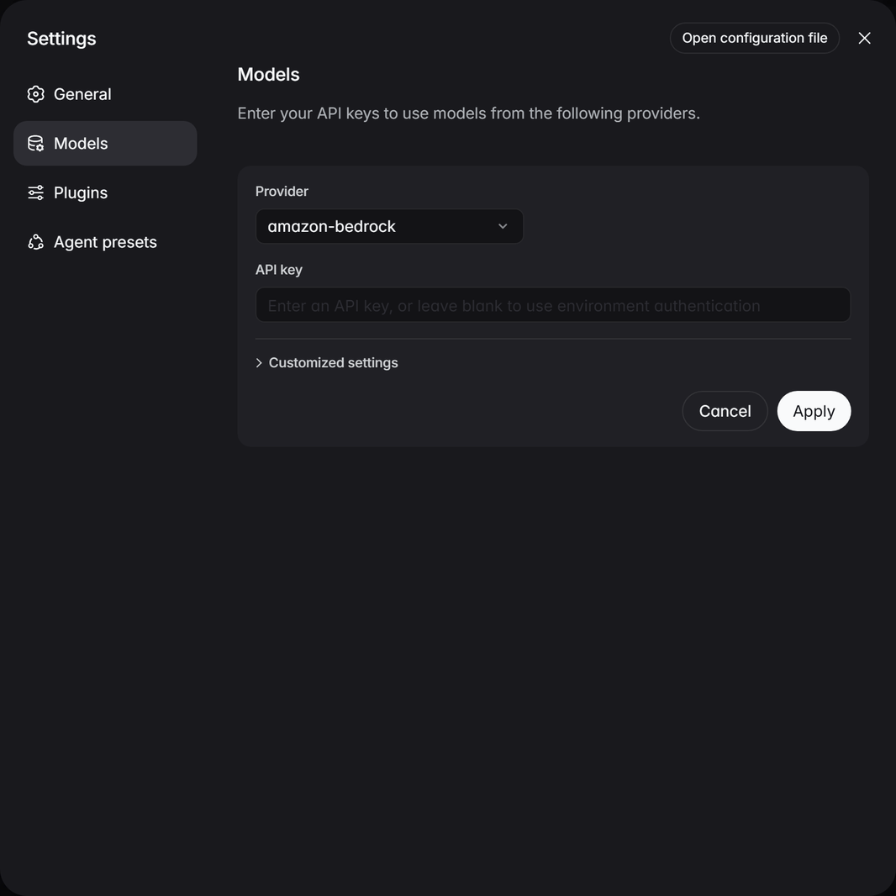</td>
<td width="50%">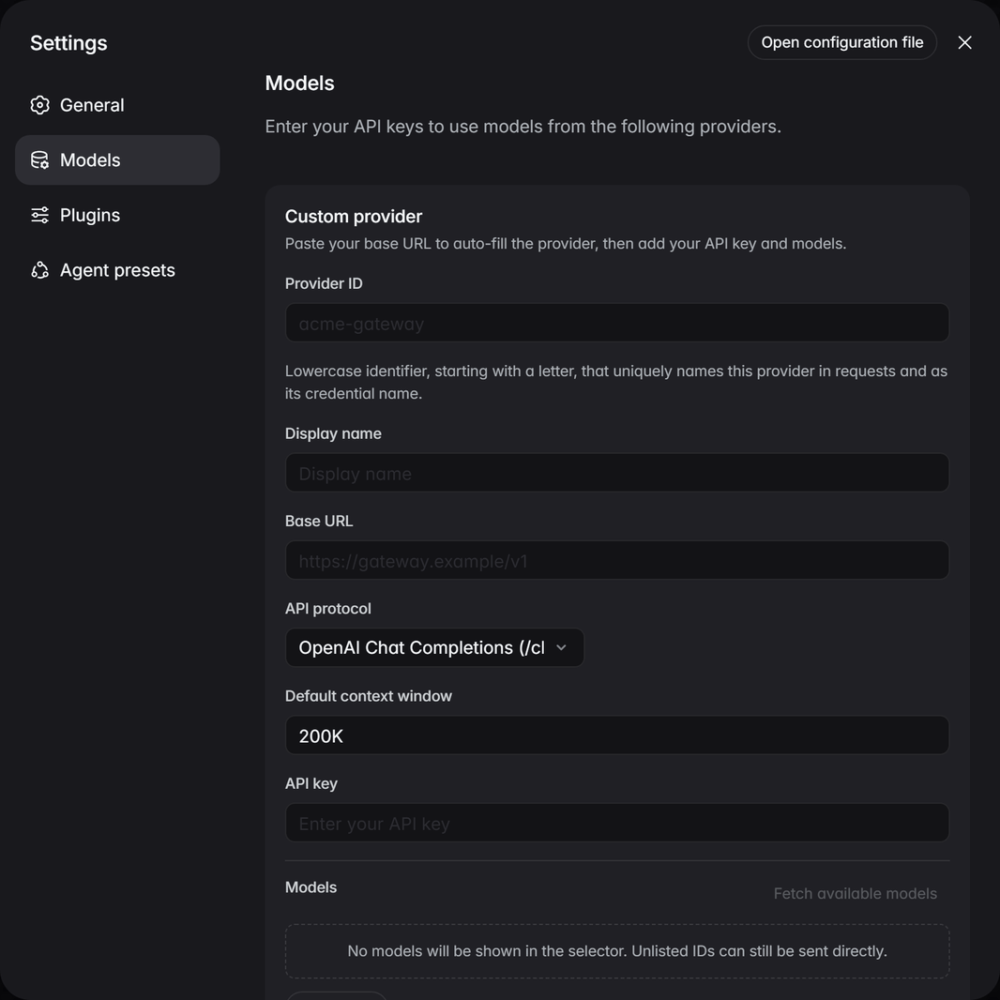</td>
</tr>
<tr>
<td><sub><b>Add provider</b>: pick a provider from the catalog and paste its key; its endpoint and models are already known.</sub></td>
<td><sub><b>Add a custom provider</b>: any compatible endpoint (gateway, self-hosted server). <b>Fetch available models</b> reads the model list from it.</sub></td>
</tr>
</table>

## A session from start to finish

The screenshots below come from one real, unedited run. The target is a small, deliberately vulnerable "Acme Shop" API on `127.0.0.1:8088`, and the workspace holds a short `SCOPE.md`.

### 1. Choose a mode and describe the job

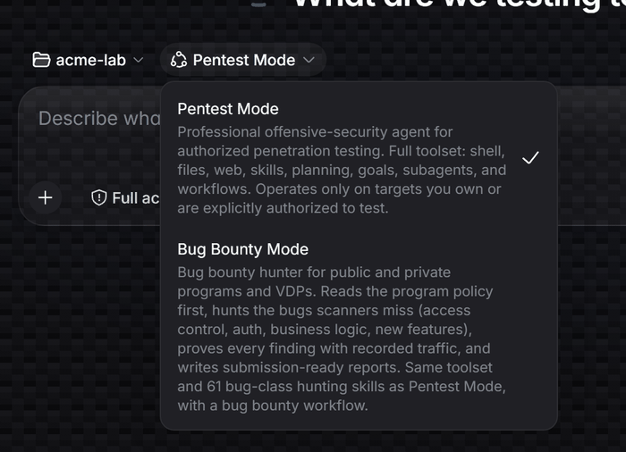

The mode (agent preset) decides the agent's persona, workflow and tools:

- **Pentest Mode**: an engagement workflow. Recon first, then systematic testing, every finding proved and recorded, a report at the end.
- **Bug Bounty Mode**: reads the program policy first, hunts the classes scanners miss (access control, auth, business logic, new features), and writes submission-ready reports.

Both share the same toolset and the same 63 bug-class skills. You can duplicate either one and edit it, or let the agent draft a new preset, under **Settings → Agent presets**.

The composer also sets the session's **permission level** (Read Only, Workspace Write or Full access) and its **model**.

<br clear="right" />

### 2. The agent sets scope and starts recon

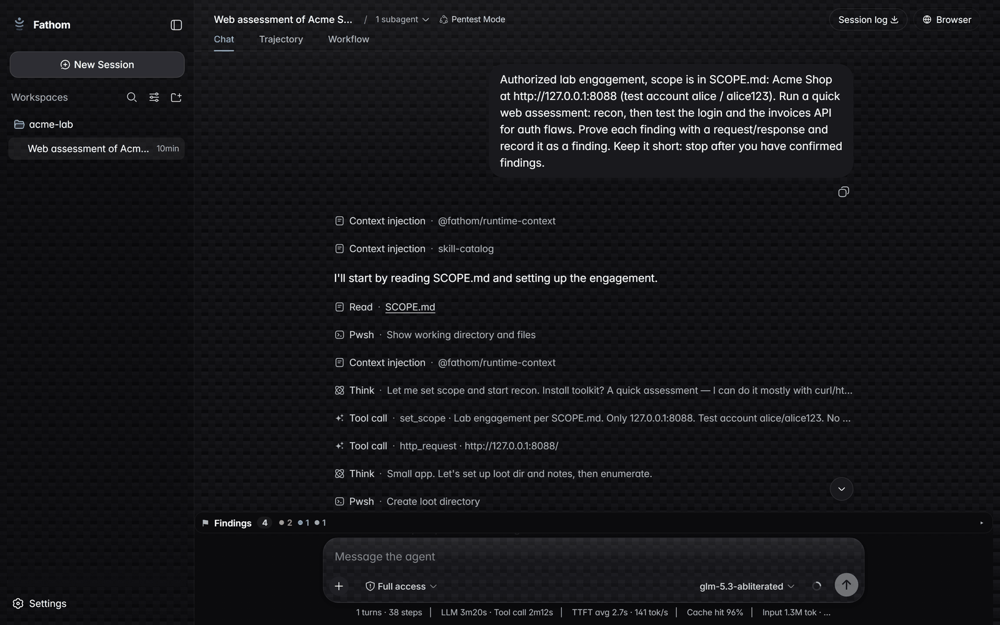

It reads `SCOPE.md`, declares the scope with `set_scope` (from then on, anything outside `127.0.0.1:8088` is blocked), and starts mapping the app. Every step is a row you can expand: thinking, shell commands, file reads and edits, and tool calls.

### 3. The toolkit installs itself

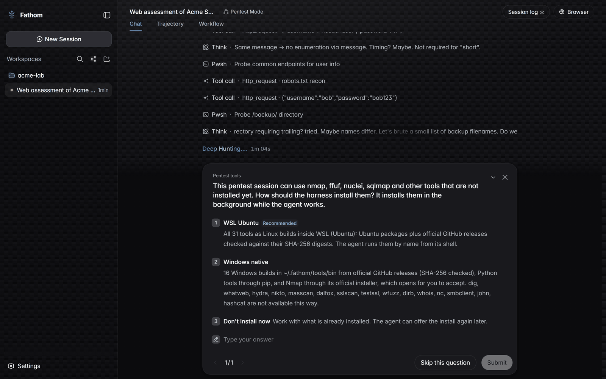

On the first pentest session Fathom asks once how to install its toolkit of 31 tools (nmap, ffuf, nuclei, sqlmap, httpx, subfinder, katana, gobuster, hydra, testssl and more), then installs it in the background **while the agent keeps working**. On Windows it uses WSL Ubuntu or native Windows builds; on Linux it installs natively. Release downloads are checked against their published SHA-256 digests. The answer is saved, and later sessions install whatever is missing without asking.

### 4. Every finding is proved with recorded traffic

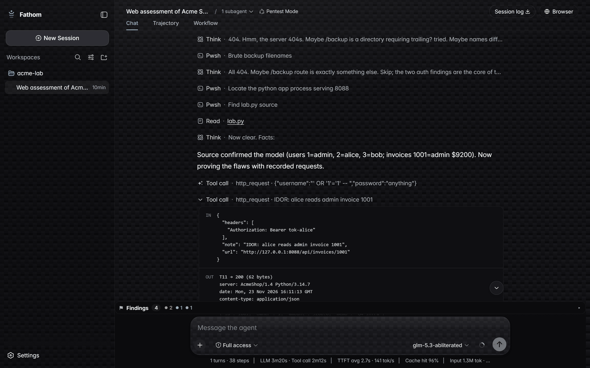

Expanding a row shows exactly what was sent and received. Here the agent uses Alice's token to read invoice `1001`, which belongs to the admin. The exchange is saved as `T11` and attached to the IDOR finding as evidence.

### 5. A second agent checks the work

Fathom does not let the finder grade its own work. For each finding the agent calls `validation_brief`, which builds a task from the write-up alone (claims, threat model, steps, expected results, plus your intended and do-not-test notes), and hands it to a **fresh validator subagent**. The validator reproduces each claim and records its verdict with `record_validation`; the finding's own session is refused, and a "not reproduced" verdict must list the attempts behind it. Only a "reproduced" verdict lets a finding be marked verified.

It works: in this run a validator caught an overstatement. The first write-up said the SQL injection gave admin access, but the admin token it returns is never accepted by the API, so the finding went from high to medium and was rewritten. Severity in a Fathom report is what was reproduced, not what was hoped for. (A second run with an intended-design note and an off-limits endpoint is shown under [Top features](#top-features).)

### 6. Report

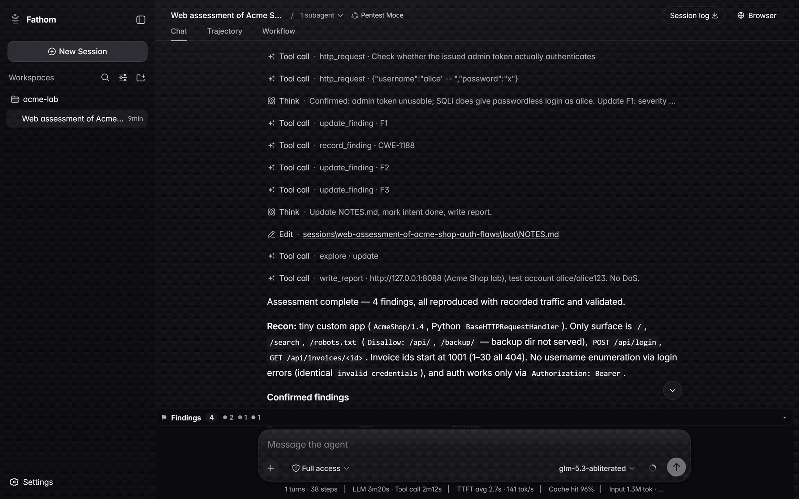

`write_report` renders the findings store into `findings-report.md`, `findings-report.json` and a self-contained `findings-report.html` dashboard; Bug Bounty Mode can also write one submission-ready file per finding. The **Findings** bar under the conversation (shown at the top of this page) lists every finding with severity counts. Selecting one shows how it was found, why it happens, how to reproduce it and how to fix it.

### 7. See the whole run

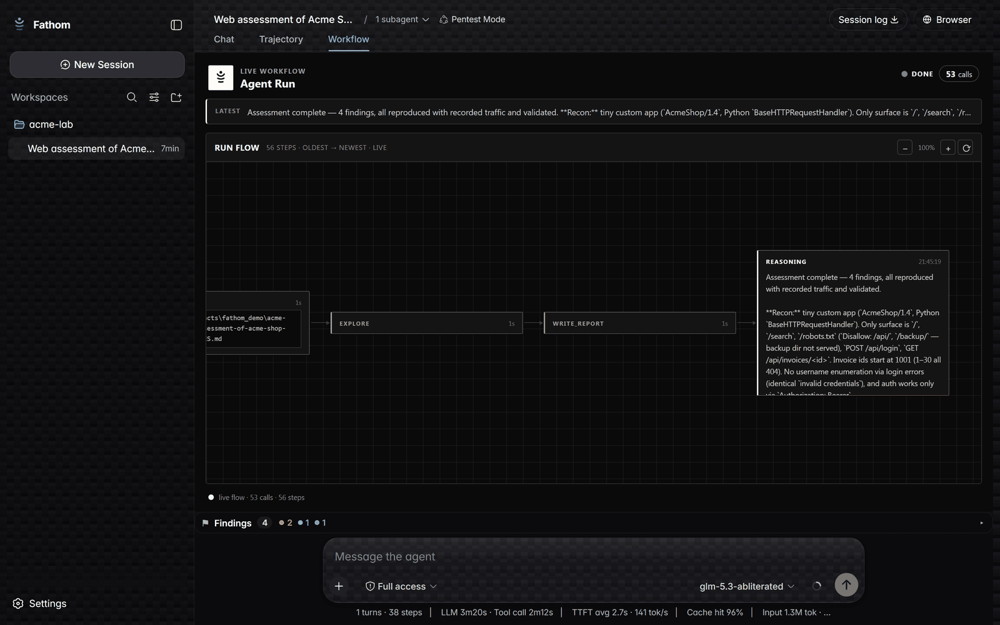

Besides **Chat**, each session has a **Trajectory** tab (every model turn and tool call in a searchable table with timings) and a **Workflow** tab (a live graph of the run). The footer shows turns, steps, model and tool time, time to first token, cache hit rate and token use. **Session log** downloads the whole session.

## Features

### Pentest and bug bounty workflow

| | |
|---|---|
| **Agent presets** | Pentest Mode and Bug Bounty Mode ship built in. A preset is a full plugin composition (prompt, tools, skills, workflow), so you can copy one and change it, or build your own. |
| **63 bug-class skills** | Method and triage, reporting, and one `hunt-*` skill per class: IDOR, auth bypass, ATO, OAuth, SAML, MFA, JWT, SSRF, RCE, SQLi, NoSQLi, SSTI, XXE, XSS, CSRF, CORS, GraphQL, gRPC, WebSocket, LLM features, framework-specific skills and more. The agent loads the one it needs. ([bounty-skills](packages/pentest/bounty-skills/README.md)) |
| **Engagement memory** | An asset graph of the target side; an exploration graph of what was tried, what it yielded and what is ruled out; and an engagement map that shows which asset × bug-class pairs are still untested. ([tool-engagement](packages/pentest/tool-engagement/README.md)) |
| **Findings store** | `record_finding`, `update_finding`, `list_findings`, `validation_brief`, `record_validation` and `write_report`, with CWE, threat model, reproduction, impact, remediation and bound traffic. ([tool-findings](packages/pentest/tool-findings/README.md)) |
| **Pentest toolkit** | 31 tools installed and kept available by the harness (WSL Ubuntu, Windows native, or Linux). ([pentest-toolkit](packages/pentest/pentest-toolkit/README.md)) |

### Guardrails

The [pentest guard](packages/pentest/pentest-guard/README.md) sits in front of every tool call:

- **Scope gate**: shell commands, `http_request`, browser navigation and web fetches are scanned for hosts, IPs and CIDRs. Out-of-scope targets are refused, and widening the scope asks you.
- **Approval rules**: online brute force, sqlmap OS shells, Metasploit and similar ask first; DoS tooling and destructive commands are denied.
- **Noise governor**: flags loud scanner settings (`nmap -T5`, unbounded `ffuf`, `nuclei` without a rate limit) and caps requests per host per minute.
- **Prompt-injection framing**: target output that tries to instruct the agent ("ignore previous instructions", fake system tags) is wrapped as untrusted, and the agent is told not to act on it.

On top of that, each session runs at a **permission level**: Read Only, Workspace Write, or Full access.

### A browser you share with the agent

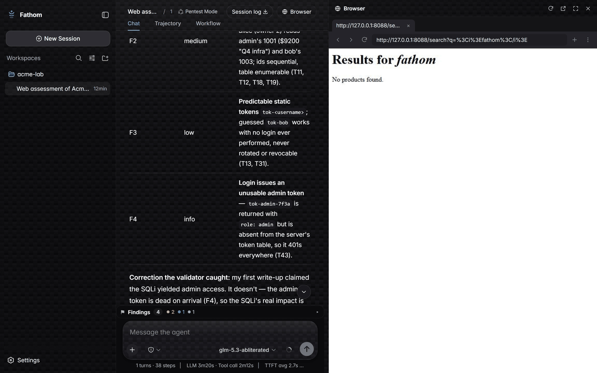

The agent drives a real Chromium, and you see the same browser in the **Browser** panel. Each session gets its own tab. You can take over at any time, for example to solve a CAPTCHA or sign in, then hand control back.

### Long sessions

- Sessions are saved as they run and can be resumed, renamed, searched and forked.
- Context is compacted automatically as it fills. Scope, assets, findings and the finished-work ledger live in files, so nothing important is lost.
- **Subagents** run focused jobs (like the validator above) in parallel, each with its own context.
- **Goals**, **plans**, **to-dos**, **schedules** and **background jobs** keep multi-hour work on track.
- When the agent needs you (a question, an approval, a plan to review), it asks in the conversation, and the desktop app sends a notification.

### Desktop app

A small native window around the same web UI, for Windows and Linux (Avalonia on .NET 10, using the system web view, so no extra Chromium). It starts the harness for you, hides to the tray, notifies you when a session needs input, and has an **Update** button that pulls, builds and restarts. Setup: [docs/UPDATING.md](docs/UPDATING.md) · details: [apps/desktop/README.md](apps/desktop/README.md).

### Other ways to run it

| | |
|---|---|
| `pnpm fathom web` | The web UI (the usual way to use Fathom). |
| `pnpm fathom --profile headless "job"` | One-shot: run a single job, print the answer, exit. |
| Python SDK | Drive the agent from Python: [docs/guide/python-sdk.md](docs/guide/python-sdk.md). |
| ACP / JSON-RPC | Embed the agent in an editor or another program: [examples/](examples/). |

All launch modes are described in [apps/cli/README.md](apps/cli/README.md).

## Configuration

Almost everything is set in the UI under **Settings** and saved to `~/.fathom/settings.yaml`. Changes apply without a restart.

<table>
<tr>
<td width="50%">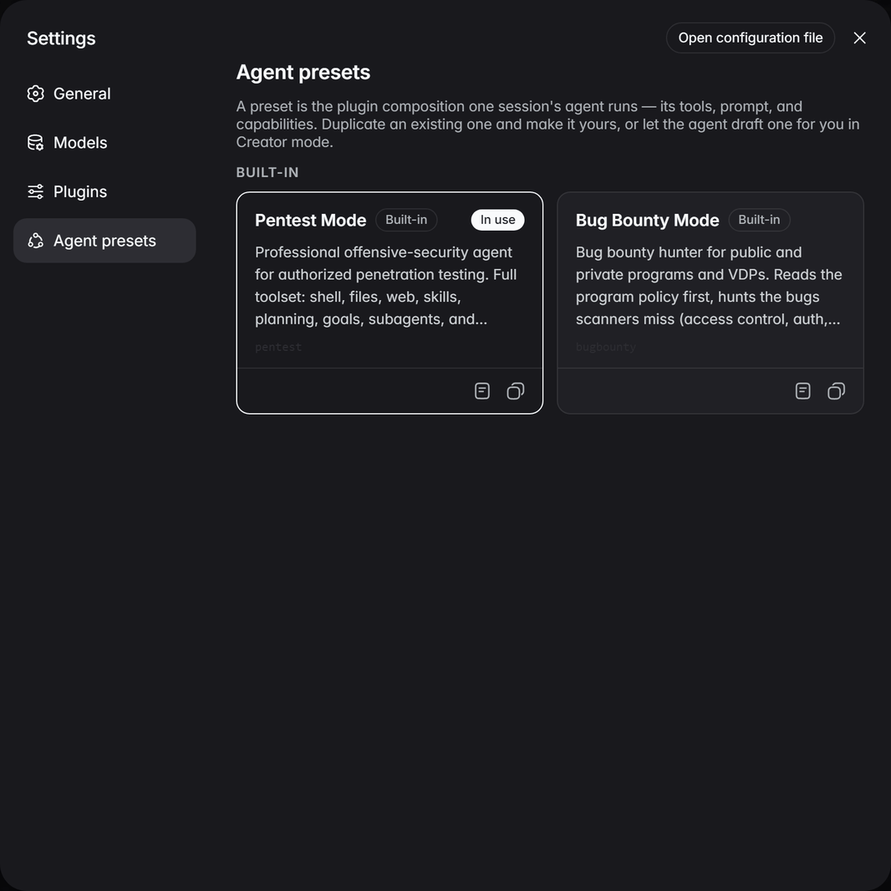</td>
<td width="50%">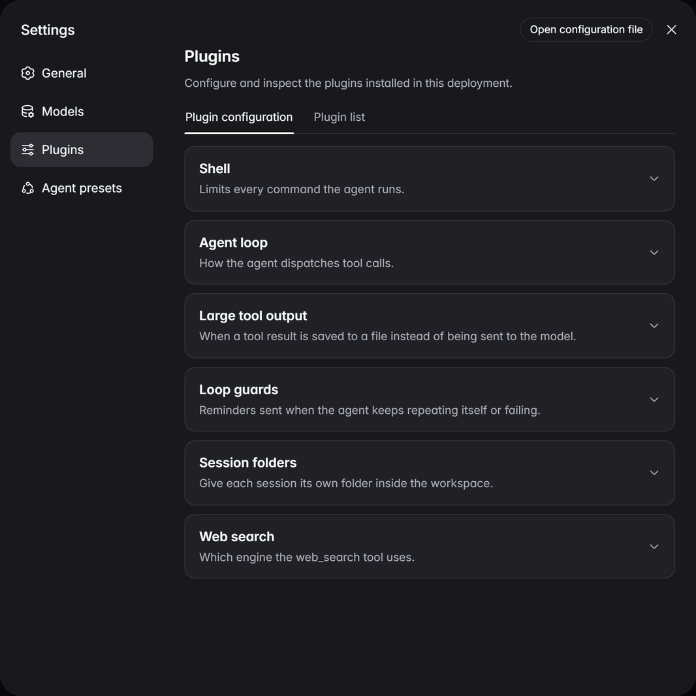</td>
</tr>
<tr>
<td><sub><b>Agent presets</b>: duplicate a built-in mode to make it your own, or let the agent draft one.</sub></td>
<td><sub><b>Plugins</b>: shell, agent loop, large-output handling, loop guards, session folders, web search engine and every other plugin's options.</sub></td>
</tr>
</table>

| What | Where |
|---|---|
| Models and API keys | **Settings → Models** · [guide](docs/guide/models.md) |
| Default mode, default permission level, appearance | **Settings → General** |
| Model for a session | The model picker in the composer |
| Plugin options (shell, web search, scope mode, noise limits, …) | **Settings → Plugins**, or **Open configuration file** · [every option](docs/config-catalog.md) |
| Agent modes | **Settings → Agent presets** |
| Data folder | `FATHOM_HOME` environment variable (default `~/.fathom`) |

## Where your data lives

Everything you own is outside the code checkout, so installing or updating Fathom never touches it.

| Path | Contents |
|---|---|
| `~/.fathom/settings.yaml` | Settings |
| `~/.fathom/.credentials.yaml` | API keys (owner-only file) |
| `~/.fathom/sessions/` | Session logs |
| `<workspace>/sessions/<session>/` | Per-session files: scope, findings, recorded traffic, notes, reports |
| `~/.fathom/tools/` | Installed pentest tools and the install choice |
| `~/.fathom/browser/` | The shared browser's profile |

## How it is built

Fathom is a plugin-based agent harness on [Cordis](docs/cordis-primer.md). The model adapter, tool registry, session log, agent loop, UI panels and pentest features are all plugins, composed at boot from profiles and bundles. There is no privileged core: any part can be replaced by mounting a different plugin.

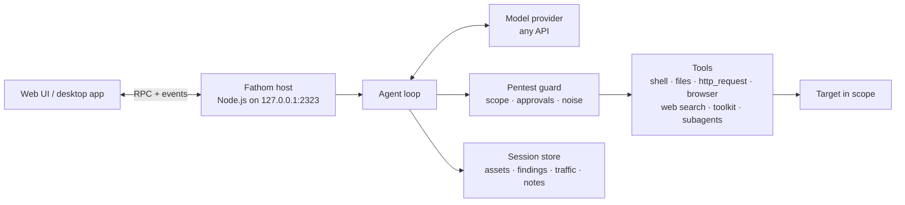

| Path | Contents |
|---|---|
| `apps/cli` | The `fathom` command, the shipped profiles and the agent presets |
| `apps/web` | The web application and its end-to-end tests |
| `apps/desktop` | The desktop app (Windows and Linux) |
| `packages/` | Every plugin, grouped by capability (`core`, `llm`, `shell`, `browser`, `client`, `pentest`, …) |
| `packages/pentest/` | Pentest guard, toolkit, engagement memory, findings, bug-class skills |
| `vendor/` | Vendored Cordis framework |
| `native/` | Landlock sandbox launcher for Linux |
| `python/` | Python SDK and its runtime |
| `examples/` | Headless, ACP and JSON-RPC example agents |
| `docs/` | Documentation (below) |

## Documentation

**Using Fathom**

- [Installing and updating](docs/UPDATING.md): web or desktop, Windows or Linux, updates, troubleshooting
- [Using the web UI](docs/guide/web-ui.md): workspaces, sessions, a first task
- [Configuring models](docs/guide/models.md): catalog and custom providers, image input, reasoning settings
- [Python SDK](docs/guide/python-sdk.md)
- [Command-line modes](apps/cli/README.md)
- Reference: [every configuration option](docs/config-catalog.md) · [every tool](docs/tool-catalog.md)

**Pentest features** (each README also shows what the model sees)

- [Pentest guard](packages/pentest/pentest-guard/README.md) · [Pentest toolkit](packages/pentest/pentest-toolkit/README.md) · [Engagement memory](packages/pentest/tool-engagement/README.md) · [Findings](packages/pentest/tool-findings/README.md) · [Bug-class skills](packages/pentest/bounty-skills/README.md)

**Extending and developing**

- [Development setup](docs/development.md) · [Testing](docs/testing.md) · [Contributing](CONTRIBUTING.md)
- [Architecture](docs/architecture.md) · [Glossary](docs/glossary.md) · [Subsystem references](docs/subsystems/README.md)
- [Cordis primer](docs/cordis-primer.md) · [Cordis tutorial](docs/cordis-tutorial/index.md) · [Cordis API](docs/cordis-api/context.md)
- Writing plugins: [your first plugin](docs/plugins/first-plugin.md) · [tools](docs/plugins/tool.md) · [configuration](docs/plugins/config.md) · [services](docs/plugins/service.md) · [events](docs/plugins/events.md) · [capability design](docs/plugins/capability-design.md) · [LLM adapters](docs/plugins/llm-adapter.md) · [publishing](docs/plugins/publish.md)
- Cookbooks: [add a tool](docs/cookbook/adding-a-tool.md) · [add a package](docs/cookbook/adding-a-package.md) · [add a settings card](docs/cookbook/adding-a-settings-card.md) · [add a conversation node](docs/cookbook/adding-a-conversation-node.md) · [add a vendored package](docs/cookbook/adding-a-vendored-package.md) · [extensions](docs/cookbook/extension-cookbook.md)
- [Post-mortems](docs/postmortem/README.md): bugs that got through, and the guardrails added afterwards

## Use it responsibly

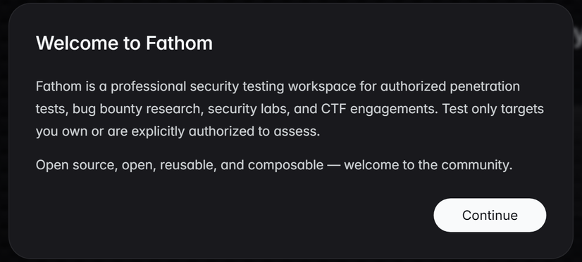

Fathom is for systems you own or are explicitly authorized to test: your own applications, contracted engagements, bug bounty programs within their published scope, labs and CTFs. Authorization and scope are your responsibility; the scope gate is a safety net, not permission. Read each program's rules before testing, respect rate limits, and do not access other people's data beyond what is needed to prove an issue.

<br clear="right" />

## License

[MIT](LICENSE). Fathom builds on an MIT-licensed upstream project whose copyright notice is kept in the license. The bug-class skills keep their upstream CC BY 4.0 license ([attribution](packages/pentest/bounty-skills/ATTRIBUTION.md)). Third-party software is listed in [THIRD_PARTY_NOTICES.md](THIRD_PARTY_NOTICES.md).
