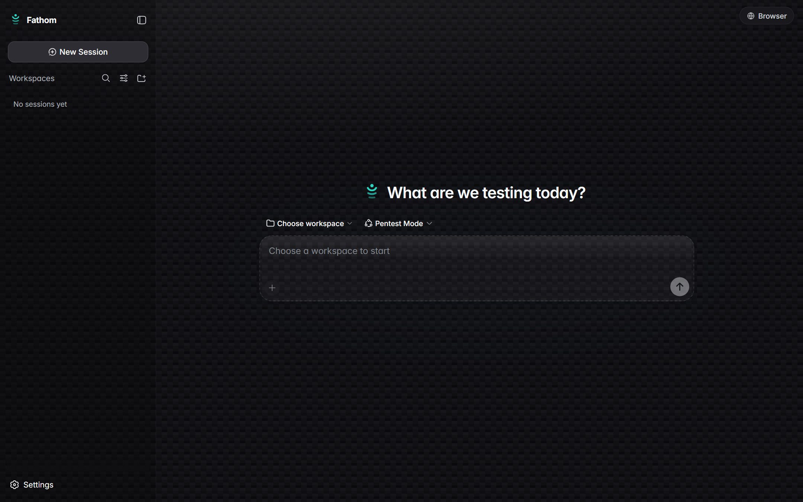
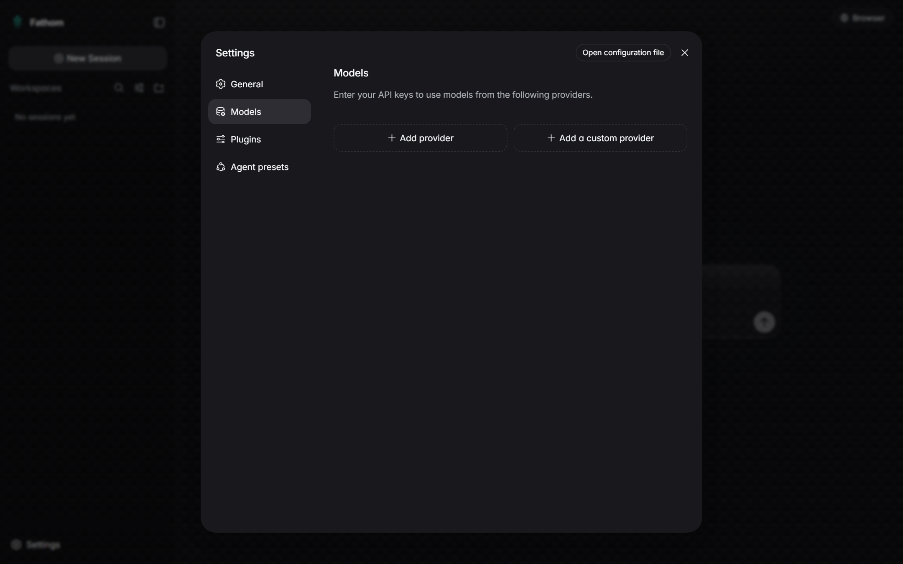

<div align="center">


</div>

**Fathom** is an AI agent workspace for authorized security testing: penetration tests, bug bounty research, labs and CTFs. You bring any AI model; Fathom gives it a shell, a real browser, a pentest toolkit and a disciplined way of working, in a local web UI or a desktop app for Windows and Linux.

| Workspace | Models |
|:---:|:---:|
|  |  |

## What it does

- **Any model.** OpenAI, Anthropic, Google, Mistral, Groq, OpenRouter, Azure, or any OpenAI-compatible gateway. Paste a base URL and key; models are discovered for you.
- **Pentest Mode.** An agent persona and tool set for engagements: recon first, evidence for every finding, a running notes ledger so long sessions don't repeat work.
- **Real tools.** Shell, files, web search and fetch, a shared Chromium the agent drives while you watch (and take over for CAPTCHAs and sign-ins), and a pentest toolkit installed for you (natively on Linux, natively or through WSL on Windows).
- **Long sessions.** Sessions are saved and resumable; context is compacted automatically and finished work survives compaction.
- **Desktop app.** A native window with notifications when the agent needs you, a tray icon, and an **Update** button that pulls, builds and restarts for you.
- **Keys stay local.** Credentials live in an owner-only store in `~/.fathom`, never in settings files or logs.

## Quick start

Requires Git, [Node.js](https://nodejs.org) 20+ (22 recommended) and pnpm (`npm i -g pnpm`).

```sh
git clone https://github.com/Pro-Nil/fathom.git
cd fathom
pnpm install
pnpm build
pnpm fathom web
```

Open **http://127.0.0.1:2323**, go to **Settings → Models**, add a provider, and start a session. Use `pnpm fathom web --port 3000` for another port.

**Desktop app, Linux, and updating:** see **[docs/UPDATING.md](docs/UPDATING.md)**. It covers first installs (web or desktop, Windows or Linux), updates, and upgrade notes.

## Where things live

| | |
|---|---|
| Web UI | `http://127.0.0.1:2323` |
| Your data (sessions, settings, keys, tools) | `~/.fathom` (override with `FATHOM_HOME`) |
| Settings | `~/.fathom/settings.yaml` |
| Credentials | `~/.fathom/.credentials.yaml` (owner-only) |

## Use it responsibly

Fathom is for systems you own or are explicitly authorized to test. Authorization and scope are your responsibility.

## Contributing and docs

Architecture and development guides are in [`docs/`](docs/) (start with [architecture](docs/architecture.md) and [development](docs/development.md)); contribution notes are in [CONTRIBUTING.md](CONTRIBUTING.md).

## License

[MIT](LICENSE). Fathom builds on an MIT-licensed upstream project; its copyright notice is kept in the license. Third-party software is listed in [THIRD_PARTY_NOTICES.md](THIRD_PARTY_NOTICES.md).
